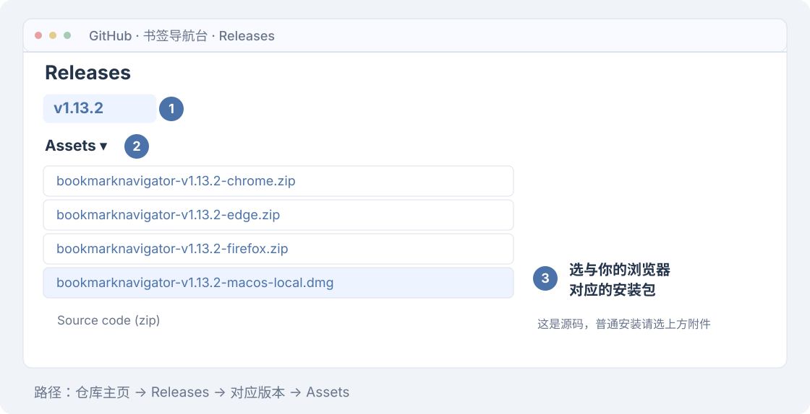
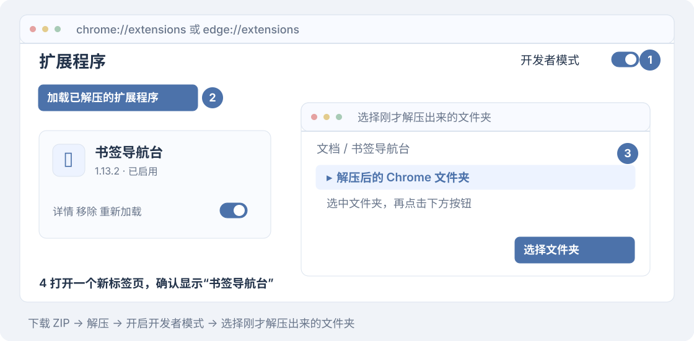
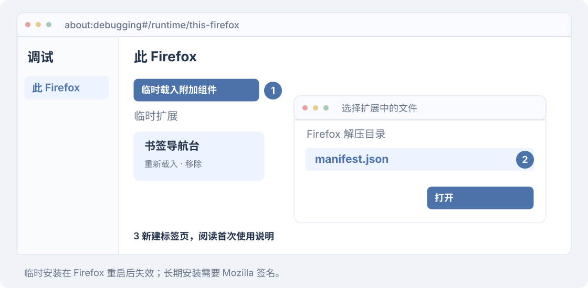
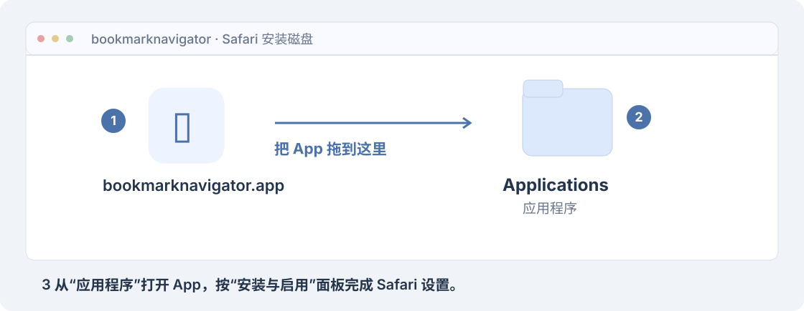
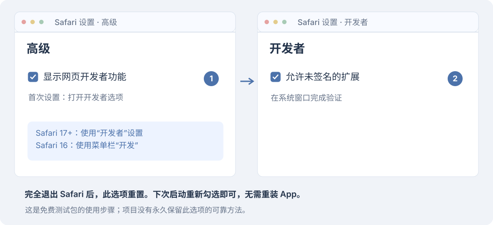
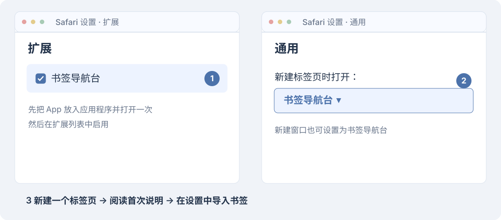
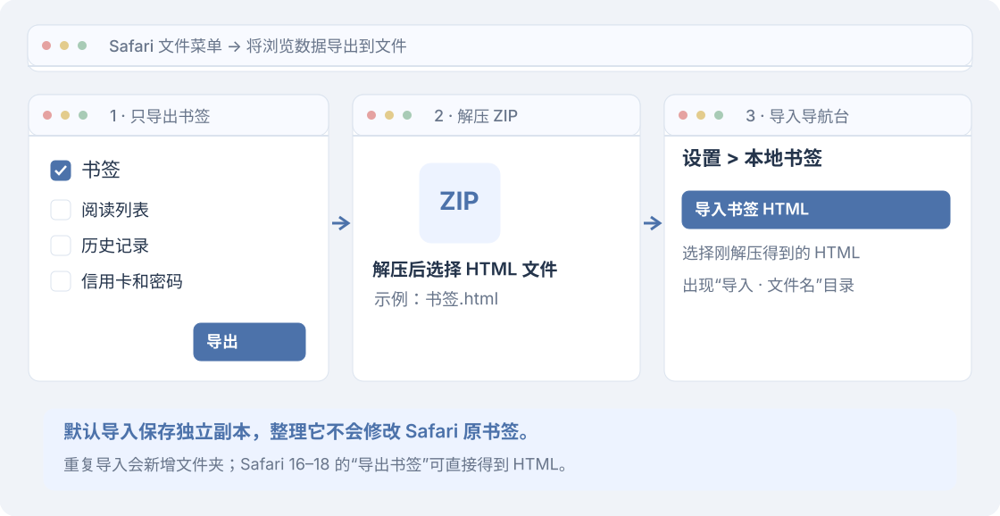

# 安装教程

先下载安装包，再选择你使用的浏览器，照着对应步骤安装。

## 下载安装包

点击下表中的文件名，直接下载对应安装包。需要查看全部文件时，[打开 v1.13.2 下载页面](https://github.com/MrMush-BUCM/bookmarknavigator/releases/tag/v1.13.2)。

| 浏览器 | 点击下载安装包 |
| --- | --- |
| Chrome | [bookmarknavigator-v1.13.2-chrome.zip](https://github.com/MrMush-BUCM/bookmarknavigator/releases/download/v1.13.2/bookmarknavigator-v1.13.2-chrome.zip) |
| Edge | [bookmarknavigator-v1.13.2-edge.zip](https://github.com/MrMush-BUCM/bookmarknavigator/releases/download/v1.13.2/bookmarknavigator-v1.13.2-edge.zip) |
| Firefox | [bookmarknavigator-v1.13.2-firefox.zip](https://github.com/MrMush-BUCM/bookmarknavigator/releases/download/v1.13.2/bookmarknavigator-v1.13.2-firefox.zip) |
| Safari | [bookmarknavigator-v1.13.2-macos-local.dmg](https://github.com/MrMush-BUCM/bookmarknavigator/releases/download/v1.13.2/bookmarknavigator-v1.13.2-macos-local.dmg) |

普通用户下载上表中的文件即可。Safari 的 [App ZIP](https://github.com/MrMush-BUCM/bookmarknavigator/releases/download/v1.13.2/bookmarknavigator-v1.13.2-macos-local.zip) 可作为 DMG 的备用格式；**Source code** 和 **safari-web-extension.zip** 是源码或开发资源。

## 选择浏览器

找到你使用的浏览器，按对应步骤安装。

## Chrome / Edge

1. **解压安装包。** 将下载的 ZIP 解压，得到一个扩展文件夹。把它放在固定位置，例如“文档/书签导航台”，以后保留这个文件夹。
2. **打开扩展管理页。** Chrome 地址栏输入 `chrome://extensions`；Edge 输入 `edge://extensions`，按回车。
3. **开启开发者模式。** 打开页面上的“开发者模式”开关，点击“加载已解压的扩展程序”。Edge 中可能显示为“加载解压缩的扩展”。
4. **选择刚才解压出来的文件夹。** 在弹出的窗口中选中它，再点击“选择文件夹”。
5. **打开新标签页。** 左上角显示“书签导航台”，阅读首次使用说明后继续。浏览器原有书签会自动出现，无需导入。

如果提示找不到清单文件，通常是选到了外面多包的一层文件夹。打开它，选里面的扩展文件夹再试一次；正确的文件夹中能看到 `manifest.json`。

官方说明：[Chrome](https://developer.chrome.com/docs/extensions/get-started/tutorial/hello-world#load-unpacked) · [Edge](https://learn.microsoft.com/en-us/microsoft-edge/extensions/getting-started/extension-sideloading)。

## Firefox

1. **解压安装包。** 将下载的 Firefox ZIP 解压。
2. **打开调试页。** 地址栏输入 `about:debugging#/runtime/this-firefox`，按回车。
3. **加载扩展。** 点击“临时载入附加组件”。在弹出的窗口中打开刚才解压的文件夹，选中 `manifest.json`，点击“打开”。
4. **打开新标签页。** 阅读首次使用说明后继续，浏览器原有书签会自动出现。

这是临时安装，Firefox 重启后需要重新加载。长期安装需要 Mozilla 签名。[Mozilla 说明](https://extensionworkshop.com/documentation/develop/temporary-installation-in-firefox/)

## Safari

适用于 macOS 12+、Safari 16+。Apple 芯片和 Intel Mac 使用同一个安装包，不需要开发者会员或 Xcode。

> 当前为未公证的免费测试包。完全退出 Safari 后，需要重新开启“允许未签名的扩展”，不必重装 App。

### 1. 安装 App

打开下载的 DMG，把 **bookmarknavigator.app** 拖到右侧的 **Applications（应用程序）**。然后打开 Mac 的“应用程序”，双击 **bookmarknavigator**。

如果 macOS 提示无法验证开发者，先核对安装包来源和校验值。尝试打开后，在“系统设置 > 隐私与安全性”中找到这个 App，点击“仍要打开”，按系统提示继续。若提示文件已损坏或会损坏电脑，请停止并检查文件。[Apple 说明](https://support.apple.com/zh-cn/102445)

### 2. 允许未签名扩展

打开 **Safari > 设置 > 高级**，勾选“显示网页开发者功能”。再切换到 **开发者**，勾选“允许未签名的扩展”。如果系统要求验证，请在系统弹窗中完成。

Safari 16 的第二步在菜单栏 **开发 > 允许未签名的扩展** 中操作。

Safari 完全退出后，这个选项会重置，下次启动需要重新勾选。目前没有可靠的永久保留方法。[Apple 规则](https://developer.apple.com/documentation/safariservices/building-a-safari-app-extension)

### 3. 启用扩展和新标签页

1. 在 App 中点击“打开 Safari 扩展设置”，勾选 **书签导航台**。
2. 打开 **Safari > 设置 > 通用**，将“新建标签页时打开”设为 **书签导航台**。
3. 新建标签页，阅读首次使用说明后继续。

### 4. 导入 Safari 书签

1. Safari 26：打开 **文件 > 将浏览数据导出到文件**，只勾选 **书签**，完成导出，再解压得到的 ZIP。旧版 Safari 使用 **文件 > 导出书签**。
2. 在导航台打开 **设置 > 本地书签**，点击 **导入书签 HTML**。
3. 选择刚才导出的 HTML 文件。Safari 26 的 HTML 在解压出来的文件夹里。
4. 返回主页，查看新建的“导入 · 文件名”分类和书签。

导入后保存的是本地副本，整理它不会修改 Safari 原书签。每次导入都会新建文件夹，重复导入会出现重复内容。

自动同步是另外开启的实验功能，普通安装不需要授权辅助功能。需要时再阅读 [Safari 自动同步](safari-sync.md)。

## 安装后检查

新建一个普通标签页，确认左上角显示 **书签导航台**。搜索一个已知书签，再到“设置 > 页面布局”调整显示或顺序，重新打开标签页确认设置已保存。

安装完成后，可以继续阅读[使用指南](usage.md)。

## 升级与卸载

更新前先用浏览器导出书签备份。Safari 本地库还需要在 **设置 > 本地书签 > 导出本地书签** 中单独备份。

| 浏览器 | 升级方法 |
| --- | --- |
| Chrome / Edge | 用新版本解压后的文件覆盖原来的扩展文件夹，再到扩展管理页点击“重新加载” |
| Firefox | 按上面的步骤，重新加载新版本的 manifest.json |
| Safari | 退出导航台 App，把新版 App 替换到“应用程序”，重新打开并检查 Safari 扩展设置 |

尽量保留原安装路径和扩展身份。卸载重装、改变 Bundle ID 或切换不同扩展，可能产生新的本地存储；Safari App 更新后也可能需要重新授权辅助功能。

卸载前先备份。卸载扩展不会删除浏览器原书签，扩展设置、待办和 Safari 本地副本可能随卸载清除。

## 常见安装问题

| 遇到的问题 | 这样处理 |
| --- | --- |
| Chrome / Edge 提示找不到清单文件 | 重新选择解压后的扩展文件夹；若有多包的一层，打开后选择里面的文件夹 |
| 新标签页没有变化 | 检查扩展是否启用，关闭其他接管新标签页的扩展，再新建普通标签页 |
| Safari 扩展列表没有书签导航台 | 先把 App 放入“应用程序”并打开一次，允许未签名扩展，再关闭、重新打开扩展设置 |
| Safari 新标签页仍是原页面 | 在 Safari“设置 > 通用”中检查“新建标签页时打开” |
| Safari 页面没有书签 | 按上面的第 4 步导入 HTML；已开启实验同步时，查看上次成功同步时间 |

仍有问题，请联系 [bookmarknavigator@163.com](mailto:bookmarknavigator@163.com)，说明系统、浏览器、扩展版本和操作步骤。
