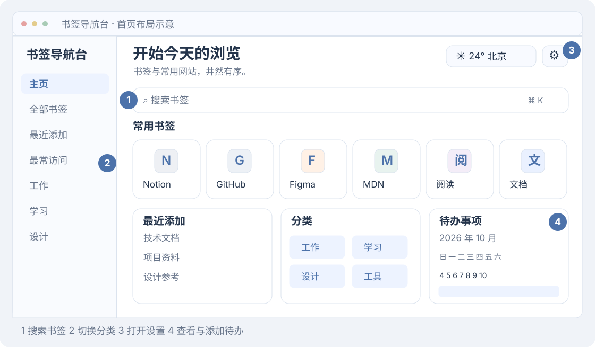
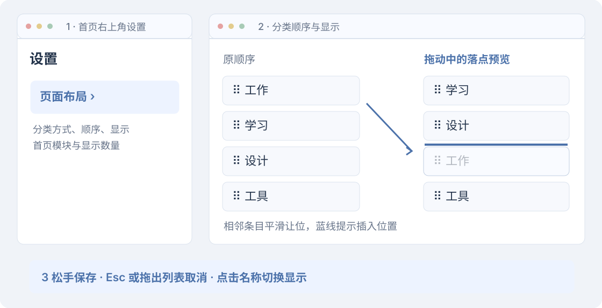
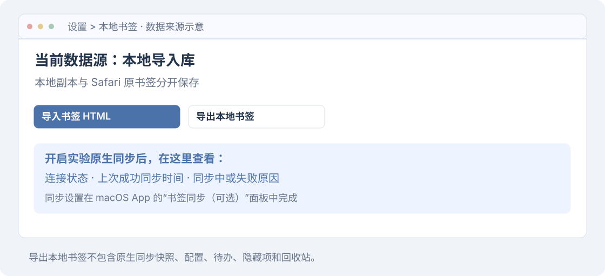

# 日常使用指南

安装完成后，从搜索书签和调整首页开始。需要时再整理书签、添加待办或设置天气。

## 认识首页

左侧用于切换主页、全部书签、最近添加、最常访问和分类；右上角进入设置与天气详情。主区域显示常用书签、最近添加、分类入口和日历待办。

图中书签名称与数据均为虚构示例。实际内容由你当前的数据源和布局设置决定。

## 找到并打开书签

1. 在搜索框输入网站名称或网址的一部分。`Ctrl + K`（Windows）或 `⌘ + K`（macOS）可以快速聚焦搜索。
2. 点击左侧分类查看其中书签，或进入“全部书签”浏览。
3. 点击书签卡片打开网站。“最常访问”的统计来源因浏览器不同；Safari 仅统计从导航台打开网站的次数。

## 调整分类与首页布局

1. **打开设置。** 点击首页右上角的齿轮，进入“页面布局”。
2. **选择分类方式。** “我的书签文件夹”保留现有层级；“按网站库自动分类”按内置类别展示。切换不删除原文件夹，两个模式分别保存顺序。
3. **拖动分类。** 在“分类顺序与显示”中拖动条目或左侧拖拽柄。相邻条目会平滑让位，蓝色线表示落点，松手后保存。
4. **显示或移出。** 点击分类名称切换显示；点击右侧移出按钮只将其移出面板。点击“添加”可重新加入。
5. **调整首页模块。** 同页下方可开关模块、调整数量和顺序。天气的位置固定，常用书签的首页收藏卡片置顶显示。

拖出列表后松手会取消；按 Esc 也可取消。取消不改写顺序。若系统开启“减少动态效果”，位移动画关闭，落点提示仍保留。

**“移出面板”不会删除书签。** 它与右键菜单里的真实删除不同。

## 整理书签前，确认数据源

| 数据源 | 编辑、移动与删除的影响 |
| --- | --- |
| Chrome / Edge / Firefox | 修改浏览器原书签 |
| Safari 本地库 | 修改扩展保存的副本，Safari 原书签不变 |
| Safari 原生同步 | 经核对的单个删除会影响 Safari 原书签；其他写回暂不支持 |

在书签卡片上点击右键，可找到编辑、移动分类、图标、隐藏和删除入口。在文件夹模式中，将卡片拖到左侧文件夹可移动书签。按时间或访问次数排序时，手动拖动会切换为自定义顺序。

自动分类的归属与顺序是导航台展示配置，不会重建浏览器原文件夹。

## 区分隐藏、移出与删除

| 操作 | 发生什么 | 恢复入口 |
| --- | --- | --- |
| 移出分类面板 | 分类入口不显示，书签仍在 | 设置 > 页面布局 > 添加 |
| 取消在常用书签中显示 | 仅移出首页常用区 | 常用书签的自定义入口 |
| 删除书签显示 | 隐藏导航台中的书签，原书签保留 | 设置 > 隐藏书签 |
| 删除书签 | 从当前数据源真实删除，可能触发浏览器同步 | 设置 > 回收站；Safari 同步模式需手动还原 |

回收站只记录导航台执行的单个删除，保留 30 天。整个文件夹删除、浏览器外部删除、卸载和存储丢失不在恢复范围内。批量操作前先导出备份。

## 添加待办

1. 在日历中点击目标日期，进入当天事项。
2. 选择“时间点”或“时间区间”，填写时间或开始、结束时间。
3. 选择标记颜色，在输入框写下事项，点击“添加”。
4. 使用“今天”回到当天；点击月份两侧箭头切换月份。

待办保存到扩展本地存储，不会写入系统日历，也没有云端待办同步。

## 天气与网站图标

天气城市在设置首页修改；输入城市后，从候选结果中核对国家和省市再应用。点击天气胶囊查看逐小时和逐日预报，页面布局中可隐藏天气。默认城市为北京。

天气数据由 Open-Meteo 提供，城市数据基于 GeoNames，数据采用 CC BY 4.0。温度和预报经过整理，城市候选项经过排序和去重。相关署名及许可链接显示在天气和城市查询区域；服务使用条件见[第三方资源版权与许可](../THIRD_PARTY_NOTICES.md)。

常见站点使用包内图标，未知站点显示名称首字。可在卡片右键菜单上传本地图标。需要高清网站图标时，进入“设置 > 网站图标”，主动选择网站并按提示授权；拒绝授权不影响普通书签导航。

## Safari 的本地导入、备份与同步

默认在“设置 > 本地书签”导入 HTML。每次导入创建新的文件夹，不覆盖旧副本；导入上限为 10 MB、50,000 个书签与文件夹，不支持的危险网址协议会被跳过。

“导出本地书签”输出原有本地导入库的 HTML，不包含原生同步快照、配置、待办、图标、隐藏项或回收站。切换实验自动同步不会删除本地库；关闭同步后可继续使用它。Safari 原书签的备份请用 Safari 自身的导出功能。

实验原生同步的连接状态、上次成功时间和失败原因也在此页显示。需要运行宿主 App，密码验证必须在系统窗口完成；删除前后的导出复核可能分别要求验证。[同步设置与排查](safari-sync.md#开启自动同步)

## 数据与权限

| 数据或权限 | 何时使用 |
| --- | --- |
| 书签与历史 | Chrome / Edge / Firefox 在本机读取，用于导航和访问次数；书签整理会写回。Safari 本地模式使用导入库，访问次数只统计导航点击 |
| 本地存储 | 保存布局、主题、待办、图标、隐藏项、回收站，以及 Safari 的本地库或同步快照 |
| Open-Meteo | 同意首次使用说明且显示天气时，发送城市名称或坐标获取天气；默认城市为北京 |
| 所选网站访问与 scripting | 主动获取高清图标时请求，用于读取所选网站的公开图标声明 |
| Safari nativeMessaging 与本机容器 | 扩展和可选助手交换书签快照、连接状态及删除请求 |
| macOS 辅助功能（可选） | 仅用于实验助手操作 Safari 的导出和书签管理界面 |

本项目不需要账号，没有自建上传服务。天气与高清图标会访问第三方，它们可以看到请求和网络信息；扩展不会为此上传整份书签列表或完整浏览历史。首次使用页及“设置 > 关于导航台”提供服务与隐私说明。

## 反馈时提供什么

请记录系统、浏览器、扩展版本，以及“点击了什么、看到了什么、期望发生什么”。可附局部截图，但遮盖私密书签、账号和其他个人信息。反馈邮箱：[bookmarknavigator@163.com](mailto:bookmarknavigator@163.com)。
